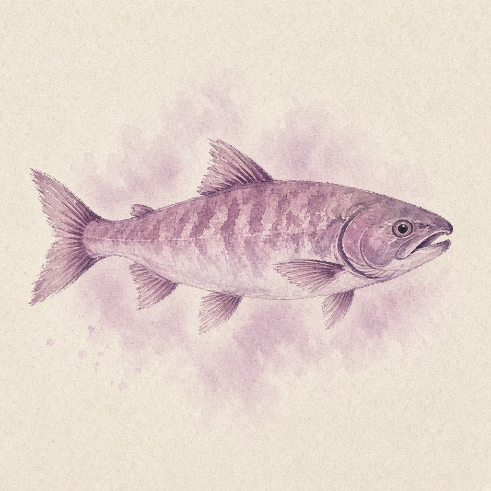

# Physical AI For Optimal Feeding Control

<p align="center">
  
</p>

<p align="center">
  <em>A Physical AI Framework for Adaptive Feeding Based on Visual Feed Dynamics</em><br/>
  Sin-Ze Yang, Cheng-Hsun Chuang, Yong-Xiang Chen*<br/>
  Undergraduate Program in Intelligent Computing and Big Data,<br/>
  Chung Yuan Christian University, Taiwan
</p>

## Abstract

Adaptive aquaculture feeding requires feedback on how the environment responds to each dispensing action. This repository implements a **Physical AI** framework that closes a perception–action loop around visible-feed dynamics: object detection estimates residual pellets in a fixed surface region, a causal Kalman filter tracks the resulting area signal over time, and a bounded decision policy proposes the next portion subject to observation-quality and safety constraints. On the perception side, six YOLO26 and RF-DETR configurations are compared on a locked image hold-out; RF-DETR-m reaches the highest overall AP50–95 (0.363), while YOLO26-m / YOLO26-s lead feed-class F1 (0.66 / 0.64) with low local pipeline latency. These results motivate feed-specific model selection rather than multiclass AP alone. Remaining gaps—feed recall below a provisional 0.75 target, same-video split leakage risk, and unverified end-to-end feeding effectiveness—are treated as open validation items, not settled claims.

## Introduction

Excess feed raises production cost and organic loading. Fixed schedules cannot track appetite shifts driven by temperature, dissolved oxygen, fish size, or health. A feedback feeder therefore needs observations that can inform the *next* dispensing action—not only a static scene label.

Beyond single-frame counts, the **change in visible feed after a portion** is a physical response of the tank surface. Interpreting that response needs (i) reliable temporal measurement and (ii) a calibrated link between disappearance and demand; detector accuracy alone establishes neither. In this project, *Physical AI* denotes the proposed loop in which dispensing alters the environment that the next decision observes: vision → causal estimation → bounded actuation, with the Raspberry Pi / BMduino prototype as the reference edge path and a server-side detector–controller as the decision host.

This codebase separates concerns accordingly:

- **`Depolyment/`** — monitoring web stack, RF-DETR inference path, streaming, and Pi controller integration.
- **`Research/`** — model-comparison benchmark and analysis notebooks.
- **`Results/`** — training / evaluation artifacts co-located with run logs.
- **`Data/`** — datasets and media used by training and evaluation.
- **`Paper/`** — manuscript sources for the accompanying technical report.

The main contributions mirrored in software are: (1) a framework that ties visual feed dynamics to subsequent dispensing decisions; (2) a causal temporal estimator and bounded feeding policy with quality and safety gates; (3) an empirical comparison of six detectors focused on feed-class accuracy and efficiency for the perception module.

## Quick start

```bash
# Runtime settings live in Depolyment/src/config/setting.py (not .env)
uv run --group ml uvicorn web.app:app --host 0.0.0.0 --port 8000

cd Depolyment/src/web/frontend && npm install && npm run dev
```

Secrets only (API keys) belong in `.env`; see `.env.example`.
