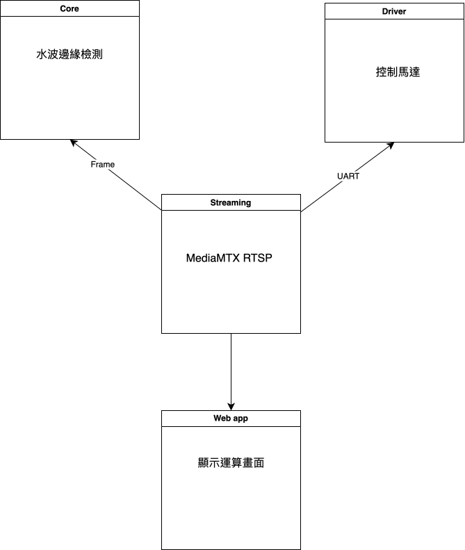

# Aquaculture_CV_Project

## 1. System Architecture


## 2. Software Architecture



### File Structure

```text
Aquaculture_CV_Project/
├── config/
│   └── setting.py                              # Extended with spatiotemporal parameters
├── core/
│   ├── activity_levels.py
│   ├── models.py                               # Extended with spatiotemporal dataclasses
│   ├── ripple_detector.py                      # Legacy simple detector
│   ├── spatial_features.py                     # NEW: Canny edges, Sobel gradients
│   ├── temporal_features.py                    # NEW: Optical flow, motion energy
│   ├── spatiotemporal_pipeline.py              # NEW: Per-frame analysis pipeline
│   └── stream_health.py
├── drivers/
│   └── README.md
├── streaming/
│   └── latest_frame_reader.py
├── tests/
│   ├── unit/
│   │   ├── test_spatial_features.py            # NEW
│   │   ├── test_temporal_features.py           # NEW
│   │   └── test_activity_fusion.py             # NEW
│   └── integration/
│       ├── test_spatiotemporal_pipeline.py     # NEW
│       └── test_monitoring_ui_contract.py      # Updated
├── validation/
│   ├── clip_manifest.py
│   └── run_clip_validation.py
└── web/
    ├── app.py                                  # FastAPI backend
    ├── streamlit_app.py                        # NEW: Streamlit UI for spatiotemporal analysis
    ├── components.py                           # NEW: Heatmap and grid rendering
    ├── detection_worker.py                     # Shared detection loop
    ├── overlay_hub.py                          # WebSocket broadcast hub
    ├── schemas.py                              # Pydantic API/WS schemas
    └── frontend/                               # React/Vite UI
        ├── src/
        └── dist/                               # Built for production serving
```

## 3. Spatiotemporal Water Ripple Analysis

The system includes real-time spatiotemporal analysis for detecting aquatic activity from water-surface video streams.

### Features

- **Real-time Activity Scoring**: Continuous 0–1 activity score updated each frame
- **Spatial Analysis**: Canny edge detection and Sobel gradient analysis over an 8×8 grid
- **Temporal Analysis**: Farneback dense optical flow and frame differencing
- **Activity Heatmap**: Per-cell activity visualization with configurable colormap overlay
- **Time-Series Tracking**: Historical activity scores with trend analysis and CSV export
- **Live Monitoring UI**: Streamlit interface with Start/Stop controls and raw/processed view toggle

### Running the Streamlit UI

```bash
streamlit run web/streamlit_app.py
```

Configure the stream source in `config/setting.py`:
- `STREAM_URL`: RTSP URL or local video file path
- `GRID_ROWS`, `GRID_COLS`: Grid dimensions (default 8×8)
- `WINDOW_FRAMES`: Temporal smoothing window size (default 30 frames)

### Testing

Run the test suite to validate feature extraction and pipeline integration:

```bash
pytest tests/unit/test_spatial_features.py -v
pytest tests/unit/test_temporal_features.py -v
pytest tests/unit/test_activity_fusion.py -v
pytest tests/integration/test_spatiotemporal_pipeline.py -v
```

## 4. Development Principles

- Use Spec-Driven Development: write the English specification before planning or coding.
- Keep specifications, plans, tasks, code comments, and docstrings in English.
- Keep modules separated by responsibility: configuration, core logic, drivers, UI, and scripts.
- Prefer simple, direct implementations over speculative abstractions.
- Define verification steps before completing changes that affect vision, feeding, actuators, or safety.

## 4. Hardware Components

### The Brain
- MPU (Rasperry Pi Zero 2W)
- MCU (BMduino)
- FC (PixHawk)

### Drone Comopnents
- Camera (Rasperry Pi 5 IMX219 79.3 degree)
- Drone Basis (F450)

## 5. Running the Monitoring UI

```bash
# 1. Start MediaMTX
docker compose -f compose.mediamtx.desktop.yml up

# 2. Build the React frontend (first time only)
cd web/frontend && npm install && npm run build && cd ../..

# 3. Start the FastAPI backend
uvicorn web.app:app --host 0.0.0.0 --port 8000

# 4. Open http://localhost:8000 in Chrome or Edge and click Start
```

**Local trusted-network only.** Do not expose the FastAPI backend, MediaMTX WebRTC endpoint, or overlay WebSockets to public networks.

## 6. Local Stream Relay Setup (MediaMTX)

The ripple monitoring feature requires a local RTSP relay (MediaMTX) to accept a smartphone camera stream and expose it to the application.

### MediaMTX Setup Without Docker

1. Download MediaMTX from https://github.com/bluenviron/mediamtx/releases
2. Start the relay with the desktop configuration:
   ```bash
   ./mediamtx mediamtx.desktop.yml
   ```
3. The relay will expose the smartphone publishing path at `rtsp://<relay-host>:8554/drone_live` and the browser WebRTC endpoint at `http://<relay-host>:8889/drone_live/whep`.

### MediaMTX Docker Setup: Windows, macOS, and Linux

Use the official generic MediaMTX image for desktop operating systems:

```bash
docker compose -f compose.mediamtx.desktop.yml up
```

This uses `mediamtx.desktop.yml`, which accepts external publishers at `/drone_live`, exposes WebRTC/WHEP on `8889/tcp`, exposes ICE on `8189/udp`, and does not include Raspberry Pi camera-only settings.

### MediaMTX Docker Setup: Raspberry Pi Camera

Use the Raspberry Pi compose file only when the relay host is a Raspberry Pi and the `/cam` path should read from the Pi camera:

```bash
docker compose -f compose.mediamtx.rpi.yml up
```

This uses `mediamtx.rpi.yml`, exposes `/drone_live` for phone or FFmpeg publishers, and exposes `/cam` for the Raspberry Pi camera when available.

The legacy Raspberry Pi image can still be built manually if needed:

```bash
docker build -f Dockerfile.mediamtx -t aquaculture-mediamtx .
```

### MediaMTX Configuration Files

- `mediamtx.yml`: default desktop-compatible configuration.
- `mediamtx.desktop.yml`: explicit Windows, macOS, and Linux relay configuration.
- `mediamtx.rpi.yml`: Raspberry Pi configuration with `/cam` using `rpiCamera`.
- `compose.mediamtx.desktop.yml`: cross-platform desktop Docker Compose entrypoint.
- `compose.mediamtx.rpi.yml`: Raspberry Pi Docker Compose entrypoint with camera permissions.

### Smartphone Stream Configuration

Configure your smartphone camera app to publish to: `rtsp://<relay-host-lan-ip>:8554/drone_live`

For example, if the relay runs on a laptop at `192.168.200.101`, publish to:

```text
rtsp://192.168.200.101:8554/drone_live
```

The application will read from: `rtsp://127.0.0.1:8554/drone_live`

**⚠️ Local Trusted Network Only**

This is a local trusted-network setup. Do not expose the FastAPI backend, MediaMTX relay, or overlay WebSockets beyond your local network. There is no login, authentication, or role-based access control. This MVP is designed for operator use on a single workstation within a protected local environment.

### Non-Goals (Not Implemented)

The following features are explicitly NOT included in the MVP:

- **Actuator controls**: No automated water treatment, feeding, or device actuation.
- **Feeding recommendations**: No algorithmic feeding guidance.
- **Fish location estimates**: No tracking of fish position or count.
- **Automatic image saving**: Frames are not automatically saved to disk.
- **Video recording**: No recording of streams or detected activity.
- **Authentication or RBAC**: No login system or role-based access control.
- **Public network exposure**: MVP is designed for local networks only.
