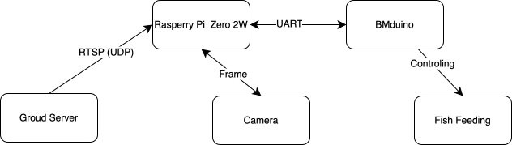

# Aquaculture_CV_Project

## Software Architecture

### System Architecture

## Hardware Components

### The Brain
- MPU (Rasperry Pi Zero 2W)
- MCU (BMduino)
- FC (PixHawk)

### Drone Comopnents
- Camera (Rasperry Pi 5 IMX219 79.3 degree)
- Drone Basis (F450)